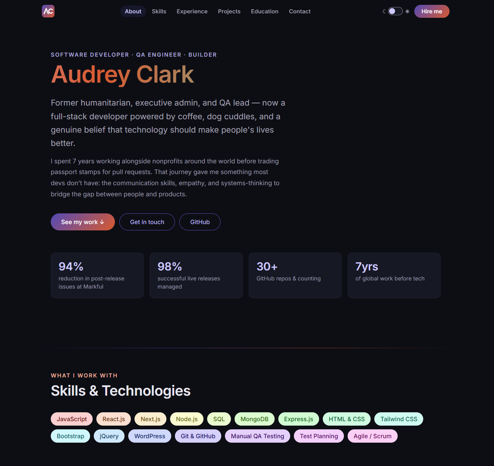

# Audrey Clark — Developer Portfolio

A single-page portfolio built with React and Vite, showcasing my journey from humanitarian work and QA engineering into full-stack software development.

## About

This portfolio was designed and built from scratch as a hands-on project while studying at the ACC Software Bootcamp. It features a dark theme with gradient accents, smooth scroll navigation, and sections for my work experience, projects, skills, education, and contact info.

## Tech Stack

- React
- Vite
- CSS (no UI library — all custom styles)
- Deployed on Vercel

## Features

- Sticky nav with active section highlighting
- Animated shimmer effect on hero text
- Fully responsive layout
- Smooth scroll between sections
- Live project links to GitHub repos

## Live Site

[audreyclark.dev](https://audreyclark.dev) ← swap in your real domain once it's live
